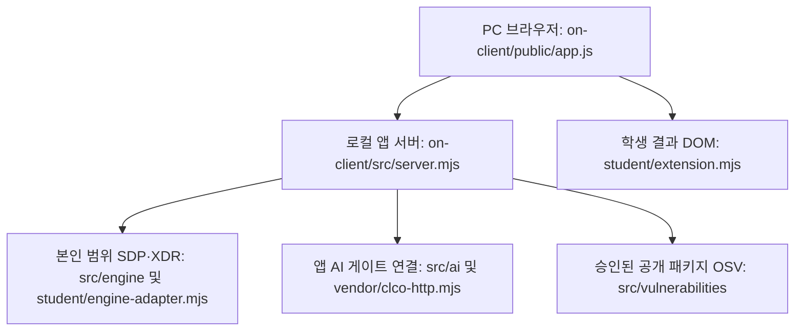

# 케셰브 학생용 실행 설명서 · 21단계

이 문서는 저장소 `rnjswnghl/keshev`의 13~20단계 로컬 앱을 다른 사람이 실행하고 확인하도록 작성했습니다. 기존 자료실의 1~12단계·보너스 기능은 저장소 최상위에 보존합니다. 학생 화면은 본인 계정·기기·현재 연결, 선택한 업무 앱 판정, 최근 보안 기록, AI 설명, 조치 상태, 승인된 공개 패키지 조회 결과를 표시합니다. 서버에 없는 연결·권한·효과를 만들어 표시하지 않습니다.

## 1. 실행 환경과 확인한 버전

| 항목 | 코드의 기준 또는 필요 조건 | 이번 확인 |
|---|---|---|
| Node.js | on-client/package.json의 engines.node는 24.19.0. 제공 실행기는 22~24를 허용하고 24.19.0을 권장 | Linux의 v24.22.1로 문법·기본·예제 서버 확인. Windows 24.19.0 실행 미확인 |
| npm | Node.js와 함께 사용하는 실행 도구 | Linux 11.9.0 확인 |
| Git | 저장소·커밋 확인 및 원문 내보내기에 필요 | Linux 2.51.1 확인 |
| PowerShell | tools/start-alekov.ps1은 Windows 경로·프로세스 처리를 사용 | Windows PowerShell 실제 실행 미확인 |
| 브라우저 | 로컬 주소를 여는 PC 브라우저. Clipboard API 복사는 브라우저 권한에 따름 | HTML 응답 확인. 실제 PC 브라우저·키보드·복사 권한 미확인 |

`on-client/package.json`에는 외부 npm 의존성이 없습니다. 로컬 앱을 켜기 위해 최상위의 Supabase 의존성을 새로 설치할 필요가 없습니다. 최상위 package.json과 package-lock.json은 별도 자료실 프로젝트의 것이며, 최상위 `npm run build`는 이 로컬 앱 실행 명령이 아닙니다. 실제 SDP·AI·조치 연결에는 담당자가 발급·설정하는 개인 호스트와 권한이 따로 필요합니다. 예제 모드나 서버 시작만으로 그 준비를 확인한 것은 아닙니다.

## 2. 작업 위치와 파일 경계

| 저장소 기준 경로 | 역할 | 작성·수정 경계 |
|---|---|---|
| README.md, package.json, package-lock.json, api/, src/, public/, xdr/ | 기존 자료실·1~12단계·보너스 기록과 실행 코드 | 기존 기능 보존. 로컬 앱과 혼동하지 않음 |
| on-client/package.json | start·demo·check 명령과 앱 버전 0.2.11 | 제공 파일 |
| on-client/src/server.mjs | 127.0.0.1에 바인딩하는 로컬 HTTP 서버와 API 경로 연결 | 제공 파일 |
| on-client/public/index.html, app.js, ai-connect.mjs, vulnerabilities-view.mjs | 세 메뉴, 요청·취소·입력 검증·학생 DOM 교체·승인 UI | 제공 파일 |
| on-client/student/extension.mjs | createStudentView와 8개 학생 렌더링 함수 | 13~20단계 학생 구현 |
| on-client/student/engine-adapter.mjs | 신뢰된 호스트의 본인 범위 엔진 기능 연결 | 기존 어댑터 유지. 기본 export는 disconnected |
| on-client/src/engine/, on-client/src/connection/ | SDP·기기·호스트 로그인 연결 | 제공 파일, 개인 권한·호스트 설정 별도 |
| on-client/src/ai/, on-client/vendor/clco-http.mjs | 앱 권한·자격 보관·AI transport | 제공 파일, 학생 렌더링에서 직접 호출하지 않음 |
| on-client/src/actions/ | 조치 준비·접수·관측과 중복 방지 | 제공 파일, 실제 학생 집행 연결은 미완료 |
| on-client/src/vulnerabilities/ | 프로젝트 lock·설치 메타데이터 대조와 승인된 OSV 조회 | 제공 파일, 허용 목록 임의 확대 금지 |
| on-client/tools/start-alekov.ps1 | 폴더·Node·포트 확인 및 서버 실행 | 기존 실행 도구 |
| on-client/.env.example | 공개 가능한 환경변수 이름·기본 예시 | 견본이며 자동으로 로드되지 않음 |
| on-client/README.md, docs/STUDENT_RUNBOOK.md | 학생 구현 기록·현재 실행 설명서 | 학생 문서. 다른 제공 문서는 보존 |

Windows의 실제 저장 위치는 이 개발 환경에서 확인할 수 없습니다. 탐색기에서 본인의 저장소 폴더를 열고 주소창에 `powershell`을 입력해 새 창을 여세요. 아래 명령으로 작업 위치를 먼저 확인합니다. 확인 결과에는 토큰·환경변수 값을 출력하지 않습니다.

```powershell
git rev-parse --show-toplevel
git remote get-url origin
git status --short
node --version
npm --version
git --version
```

Git 최상위에는 on-client 폴더와 최상위 package.json이 있어야 합니다. origin은 `https://github.com/rnjswnghl/keshev.git` 또는 같은 저장소의 동등한 Git 주소여야 합니다. 다른 저장소라면 작업을 멈추고 위치부터 확인합니다. 기존 미커밋 변경이 있어도 삭제·덮어쓰기·reset하지 않습니다. 경로를 이동할 때 공백이 있으면 큰따옴표로 감쌉니다.

## 3. 켜기·정상 시작 신호·끄기·재실행

Git 최상위에서 다음과 같이 앱 폴더로 이동합니다. 이미 on-client에 있으면 다시 이동하지 않습니다.

```powershell
Set-Location .\on-client
Get-Item .\package.json, .\src\server.mjs, .\student\extension.mjs
npm run check
npm start
```

`npm run check`는 학생 파일의 문법만 확인합니다. `npm start`는 `node src/server.mjs`를 실행합니다. 별도 터미널이나 브라우저에서 `http://127.0.0.1:5189/`를 엽니다. 기본 서버 로그는 `케셰브 연결 확인: http://127.0.0.1:5189`입니다. 이 문장의 ‘연결 확인’은 외부 엔진 연결 성공 판정이 아닙니다. 서버가 주소를 출력하고 HTTP 200으로 페이지를 제공하면 로컬 시작 신호이며, 업무 자료·AI 연결 결과는 별도로 확인해야 합니다.

제공 Windows 실행 도구를 사용하려면 `npm start` 대신 같은 on-client 폴더에서 다음을 실행합니다. 두 서버를 같은 포트로 동시에 실행하지 않습니다.

```powershell
powershell -NoProfile -ExecutionPolicy Bypass -File .\tools\start-alekov.ps1
```

이 명령의 실행 정책 옵션은 해당 실행에만 적용됩니다. 실행기는 `케셰브가 켜졌습니다. 브라우저에서 http://127.0.0.1:5189/ 을 여세요.`와 서버 응답만 확인했다는 안내를 출력합니다. 일반 실행은 서버를 켠 창에서 Ctrl+C로 종료하고, 같은 명령으로 다시 시작합니다. 이 문서에서는 프로세스 번호로 끄는 별도 절차가 필요한 `-Background`를 사용하지 않습니다.

5189가 사용 중이면 기존 프로그램을 임의로 종료하지 말고 실행기에서 다른 포트를 선택합니다.

```powershell
powershell -NoProfile -ExecutionPolicy Bypass -File .\tools\start-alekov.ps1 -Port 5190
```

이때 브라우저 주소도 `http://127.0.0.1:5190/`으로 바꿉니다. 먼저 실행한 서버와 새 서버를 혼동하지 않습니다.

실제 연결 없이 예제 표시만 확인하려면 기본 서버를 Ctrl+C로 종료한 뒤 같은 폴더에서 실행합니다.

```powershell
npm run demo
```

예제 서버 로그는 `케셰브 예제: http://127.0.0.1:5189`이며 mode는 demo입니다. 예제 자료는 실제 사용자 자료·외부 엔진 연결·AI 호출·조치 효과·공식 통과 증거가 아닙니다. 예제를 종료하고 `npm start`로 돌아오면 기본 연결 상태를 다시 확인합니다.

## 4. 글로 쓴 시스템 구성도



브라우저는 로컬 앱 서버의 `/api/*`로 요청합니다. 서버가 본인 범위의 계정·접속 판정·보안 기록을 SDP 어댑터에서 읽고, AI 앱 권한을 확인한 별도 서버 모듈로 설명을 요청합니다. 브라우저의 제공 코드가 응답을 검증·정제한 뒤 학생 렌더링 함수에 전달하고 반환 DOM으로 학생 칸을 교체합니다. 학생 함수는 AI 게이트·집행기·OSV에 직접 요청하지 않습니다.

OSV의 공개 조회 출처는 `https://api.osv.dev/v1/querybatch`입니다. 승인된 공개 패키지의 정확한 설치 버전만 서버에서 조회하며, 회사·비공개 패키지 이름을 임의로 외부에 보내지 않습니다. 실제 SDP와 AI 게이트의 개인 설정 주소·열쇠는 이 문서에 기록하지 않습니다. 기본 실행은 외부 연결이 비활성일 수 있습니다. 로컬 앱은 Vercel 배포된 기존 자료실 및 Supabase 설정과 다른 실행 단위이며, 새 저장소를 만들었다고 기존 원격 설정이 자동 연결되지는 않습니다. 기본 로컬 표시를 위해 새 Vercel·Supabase 구성을 요구하지 않습니다.

## 5. 구현한 화면과 제공 코드의 책임

| 단계·학생 함수 | 학생 구현 내용 | 제공 코드의 책임·지원 범위 |
|---|---|---|
| 13 renderIdentity | 사용자·기기·세션, 원래 상태 코드와 한국어 의미, 오류·갱신 표시 | 본인 범위 조회·세 메뉴·새 입력 전달. 기기 상태는 악성코드 검사 아님 |
| 14 renderDecision | 선택한 앱의 allow·deny·challenge·unknown, 이유·시각·실패 구분 | 앱 요청·정책 판정. allow가 실제 앱 접속 성공을 보장하지 않음 |
| 15 renderEvents | 복사 후 최신순, 세 필터, 사건별 근거·규칙·상태 상세 | 본인 최근 40건 조회. 저장된 XDR 경보만 표시 |
| 16 renderStatus 및 사건 상세 | 기기·현재 연결·알림·빈 상태·실패·안전한 도움정보 복사, 미지원 버튼 | 진단 조회·원천 상태 전달. 실제 조치 요청 없음 |
| 17 renderAiConnection | test/verified·모델 수·점검 시각·안전한 오류·초기화 | 계정·앱 승인, 수동 점검·취소. 연결 점검은 사건 설명 아님 |
| 18 renderExplanation | 현재 사건의 근거 ID·규칙·unknown·참고용 요약·미실행 제안 | 실제 설명 요청·응답 검증·세대 검사. 오류여도 기록 유지 |
| 19 renderAction | 준비·미실행·전송·ACK·관측 효과·결과 불명 구분 | 사람 확인 티켓·전송·중복 방지·재조회. 실제 학생 집행 연결 미완료(UNV) |
| 20 renderVulnerabilities | 정확한 버전·출처·시각·ID, 미조회·부분 실패·none_found 구분 | lock·설치 메타데이터 검증·허용 패키지 OSV 요청·취소·지연 응답 차단 |

OSV 대상 프로젝트와 승인 목록은 담당자가 준비합니다. `.env.example`은 변수 이름을 설명하는 견본입니다. start 명령은 dotenv나 `--env-file`을 사용하지 않아 단순히 `.env`를 만들거나 견본을 복사해도 자동 적용되지 않습니다. Windows 실행기는 비밀로 판단한 환경변수를 자식 프로세스에 넘기지 않습니다. 실제 연결이 필요하면 제공 `SDP_HOST_CONNECTION.md`, `AI_SETUP_GUIDE.md`, `STUDENT_LAUNCH_GUIDE.md`와 담당자의 발급 절차를 따릅니다. 개인 호스트 설정은 명시적 인자로 전달하며, 파일 경로·비밀값을 임의로 만들어 넣지 않습니다. 열쇠·토큰·비밀번호는 Git에서 제외되는 개인 파일·공식 보관 절차로만 관리하고 문서·커밋에 적지 않습니다.

## 6. 실제 버튼 이름과 첫 확인

| 위치 | 현재 제공 UI의 실제 이름 | 확인할 것 |
|---|---|---|
| 공통 | 보호 현황 / 업무 앱 / 보안 기록, 다시 불러오기 | 현재 자료로 교체되는지. Tab으로 메뉴 진입 후 방향키 이동 |
| 보호 현황 | AI 연결 점검, AI 연결 점검 취소 | 모델 연결 점검과 사건 설명을 구분 |
| AI 승인 연결 영역 | 현재 API 연결 점검 | 승인 연결과 점검을 구분. 단계 안내의 버튼 이름과 위치가 다를 수 있음 |
| 보호 현황 | 설치 패키지 조회, 패키지 조회 취소 | 출처·버전·시각, 취소·미조회·실패 구분 |
| 학생 상태 영역 | 도움정보 복사 | 안전한 여섯 필드만 복사. 조회 입력 반영·브라우저 권한은 직접 확인 |
| 보안 기록·조치 영역 | 대상과 조치를 확인했으며 집행합니다 / 원천 결과만 재조회 / 조치 화면 취소 | 과제 안내의 ‘연동 시스템 결과만 재조회’에 해당하는 현재 버튼은 ‘원천 결과만 재조회’. 미지원 상태에서 집행하지 않음 |

첫 직접 확인은 기존 서버·미커밋 작업을 보존한 채 새 PowerShell 창에서 2·3절을 따라 로컬 화면이 열리는지 보는 것입니다. 그다음 기본 mode와 오류 안내를 보고, 준비된 계정·권한 범위에서만 추가 기능을 확인합니다. 단계를 통과하려고 정책·인증·패키지 버전을 임의 변경하거나 유료 AI 요청·실제 조치를 반복하지 않습니다.

## 7. 장애별 확인·복구 순서

| 증상·코드 | 확인 순서 | 복구와 판단 한계 |
|---|---|---|
| npm start 스크립트 없음·파일 없음 | Get-Location → Git 최상위 → on-client/package.json 및 src/server.mjs 존재 | on-client로 이동. 기존 자료를 지우거나 새 시작 틀로 덮어쓰지 않음 |
| Node 없음·버전 거부 | node --version → 실행기 허용 22~24·권장 24.19.0 대조 | 기준 버전 설치 후 새 PowerShell에서 재확인. 이 문서는 설치를 실행하지 않음 |
| EADDRINUSE·포트 사용 중 | 이미 켠 서버가 있는지 확인 → 해당 브라우저 주소 확인 | 다른 프로그램을 임의 종료하지 않고 실행기 -Port 5190 사용 |
| ENGINE_NOT_CONNECTED / 503 | 페이지 시작 성공과 엔진 미연결을 분리 → 기본/demo 모드 → 담당자 개인 SDP 설정 여부 | 기본 실행에서 가능한 상태. 제공 호스트 연결 문서·담당자 확인. 가짜 connected로 바꾸지 않음 |
| NATIVE_HOST_DISABLED | 계정 연결 확인의 시작 응답 → 개인 호스트 설정 전달 여부 | 담당자의 호스트 준비·정식 실행 절차 확인. 학생 렌더링만으로 해결되지 않음 |
| ON_AI_PROVISIONING_PENDING·인증·접근 제한 | 계정 연결 → 앱 승인 → 현재 권한 확인 | 담당자에게 발급·권한 확인. 원본 열쇠 복사·대체 모델 연결 금지 |
| AI 시간 초과·취소·한도 | 현재 안전한 code → 취소/한도/시간 초과 안내 구분 | 원인 확인 후 제공 버튼으로 직접 재점검. 자동 요청 없음, 사건 설명 성공으로 처리하지 않음 |
| ON_AI_INVALID_INPUT / OUTPUT | 선택 사건·근거 ID·규칙·응답 형식 대조 | 없는 근거 생성 금지. 오류 이유와 기록 유지 확인. 다른 기록 재선택은 수동 |
| 조치 unknown·timeout·expired | 현재 사건·대상·requestId·receiptId·관측 상태 확인 | unknown은 결과만 재조회, expired는 다시 준비. ACK·취소를 실제 효과나 원복으로 해석하지 않음 |
| OSV not_configured / not_checked | 전체 상태 → 담당자의 대상 프로젝트·공개 승인 목록 준비 여부 | 미조회 상태이며 취약점 없음이 아님. 학생이 설정 확대하지 않음 |
| OSV unverifiable / partial / error | lock·설치 대조 가능 여부 → 이미 받은 ID → 취소·시간 초과 안내 | 부분 ID 보존, 제공 버튼으로 직접 재조회. none_found도 앱 안전 보장 아님 |
| 도움정보 복사 실패 | 학생 칸 진단 입력 유무 → 도움정보 불러오기 → 권한 안내 | 제공 진단 조회 뒤 학생 칸 반영과 복사 권한 직접 확인. 전체 응답·비밀을 복사하지 않음 |

## 8. 확인 기록과 미확인 범위

2026-10-26에 문서·실행 코드·설정 견본·첨부 도구 원문을 대조했습니다. 이 기록은 포털의 공식 통과 판정이 아닙니다.

| 검사 | 구분 | 결과 |
|---|---|---|
| package 스크립트·시작 로그·포트·실제 버튼·API 연결 경로 | 코드 읽기 | 경로·역할 확인. 예시와 실제 이름 차이를 위에 명시 |
| 13~20단계 학생 함수의 상태 분기·교체·텍스트 표시 | 이전 단계 모의 DOM 검사 | 각 단계 README에 기록. 실제 엔진·AI·집행 성취와 다름 |
| Linux Node 24.22.1의 기본 서버 | 실제 로컬 실행 | 충돌을 피한 임시 포트 50279, / HTTP 200, /api/me HTTP 503·disconnected·ENGINE_NOT_CONNECTED 확인 후 종료 |
| 같은 환경의 예제 서버 | 실제 로컬 실행 | 임시 포트 51425, / HTTP 200, /api/me HTTP 200·demo 확인 후 종료 |
| 첨부 student-source-cli.mjs --help | 실제 도구 실행 | 프로젝트 최상위·출력 절대 경로·40자리 commit 옵션·업로드 없음 확인 |
| Windows 새 PowerShell·기본 5189·실제 PC 브라우저·Clipboard API | 미확인 | 사용자가 문서대로 직접 확인할 항목 |
| 실제 계정 SDP·XDR, AI 게이트 사건 설명, OSV 외부 조회, 실제 조치 결과 | 미확인 또는 미완료 | 담당자 권한·원천 연결 필요. 특히 실제 집행 연결·같은 신원·대상의 효과 확인은 전체 목표에 남음 |
| 공식 21단계 판정·진도 | 미확인 | 사용자가 같은 저장소·커밋을 제출한 뒤 포털 결과 확인 |

## 9. 21·22단계 커밋과 원문 제출

현재 워크벤치 「포털 제출 준비」 지원 범위는 과제 안내상 13~20단계입니다. 21·22단계는 과제 화면에 저장소 주소와 실제 40자리 커밋을 직접 입력합니다. 공개 전환은 필요하지 않습니다. 원문 전달 성공과 AI 통과는 다릅니다. 아래는 제출 절차 안내이며 이 개발 작업에서 단계 제출·업로드를 대신 실행하지 않습니다.

1. Git 최상위에서 `git status --short`로 기존 작업을 먼저 확인합니다. 이번 문서와 README만 선택해 커밋하고 push합니다. 다른 변경을 일괄 추가하거나 지우지 않습니다. 이 단계는 앱 함수·서버·인증 설정을 수정하지 않습니다.
2. 첨부 ZIP의 구성은 alekov-source-tool/student-source-cli.mjs와 같은 폴더의 두 보조 모듈·README.md입니다. 폴더 전체를 프로젝트 밖에 압축 해제하고 출력 폴더도 프로젝트 밖에 미리 만듭니다.
3. Git 최상위에서 아래를 실행합니다. **본인의 실제 도구·출력 폴더로 바꾼 예시이며 확인된 Windows 경로가 아닙니다.** `$stage21Commit`은 제출할 문서 커밋을 checkout한 상태에서 읽어 옵니다. 최종 답변의 40자리 커밋과 일치하는지 대조하고, 다른 커밋이면 중단합니다.

```powershell
# 반드시 Git 최상위에서 실행합니다(on-client 하위가 아님).
$stage21Commit = (git rev-parse HEAD).Trim()
$stage21Commit
node "C:\도구\alekov-source-tool\student-source-cli.mjs" --commit $stage21Commit --output "C:\제출자료\keshev-stage21-source.json"
```

출력 폴더는 미리 존재해야 하고 JSON은 새 파일이어야 합니다. 도구는 기존 파일을 덮어쓰지 않습니다. 파일이 이미 있으면 기존 것을 보존하고 새 파일명을 선택합니다. 미커밋 변경은 묶지 않으며 학생 코드를 실행하거나 네트워크 업로드하지 않습니다. 이 CLI가 생성하는 JSON에는 선택 커밋의 원문이 들어가므로 커밋에 비밀이 없어야 합니다. `.gitignore`는 이미 추적된 파일을 소급하여 빼주지 않습니다.

4. 과제 화면의 저장소를 `https://github.com/rnjswnghl/keshev.git`, 커밋을 `$stage21Commit`과 같은 40자리로 지정하고 단계 21을 확인합니다. 비공개라면 생성한 JSON을 「비공개 저장소 원문 묶음」에서 선택한 뒤 본인이 제출합니다. 원문 전달만 실패하면 기존 접수를 유지하고 「원문만 다시 보내기」를 사용합니다.
5. 서버 상태·판정 설명을 확인합니다. CLI 실행·JSON 생성·원문 전달은 공식 통과 인증이 아니며, 서버 역시 문서의 명령을 실제 실행해 재현한 것은 아닙니다. 22단계에는 해당 단계 문서 커밋과 새 파일명으로 같은 원칙을 적용합니다.


## 10. 21단계 재검토 · 기존 자료실의 공개 키 하드코딩 제거

21단계 제출 전 비밀정보 의심 필터가 원문 전송을 보류했습니다. 저장소의 추적 파일을 다시 검사해 실제 .env가 없고 .env.example만 있는 것을 확인했으며, 기존 자료실 api/auth.js와 src/attack-check.mjs에서 Supabase publishable key 리터럴 두 곳을 확인해 제거했습니다. 이는 공개용 키이며 서버 비밀키가 발견됐다는 뜻은 아닙니다. 서버가 탐지 위치를 제공하지 않아 이 두 값이 보류의 정확한 원인인지는 미확인입니다. 테스트의 모의 인증 문자열과 제공 코드는 필터를 피하려고 변형하지 않았습니다.

기존 자료실의 api/auth.js는 이미 지원하던 SUPABASE_PUBLISHABLE_KEY 환경변수만 사용합니다. Vercel의 해당 프로젝트 Settings → Environment Variables에서 같은 Supabase 프로젝트의 공개용 키를 사용자가 직접 설정하고, 필요하면 다시 배포해야 합니다. 값은 문서·코드·대화에 붙이지 않으며 SUPABASE_SECRET_KEY로 대체하지 않습니다. 누락·빈 값이면 인증 API는 외부 요청 없이 503을 반환합니다. 기존 발급자·허용 출처·요청 필드와 응답 전달 방식은 유지합니다. 운영 환경변수 설정 여부와 실제 로그인은 미확인입니다. 로컬 on-client 표시에는 이 자료실 환경변수가 필요하지 않습니다.

src/attack-check.mjs의 runAttackChecks(config)는 기존 제한 계약에 따라 환경변수 접근을 추가하지 않습니다. anon_data_api는 키를 전달하지 않는 익명 GET이며, 응답 상태·URL 해시·응답 바이트만 측정합니다. 그 결과만으로 공개 키를 사용한 RLS 검사나 계정별 권한 검사가 끝났다고 판단하지 않습니다. 기존 서버 비밀키를 자기 점검에 넣지 않습니다. 키 하드코딩 제거는 이번 요청으로 명시적으로 승인한 기존 자료실의 변경이며 on-client의 제공 서버·UI·학생 함수는 바꾸지 않았습니다.

이번 수정은 Node.js 문법 검사, 기존 자기 점검 테스트 8개, 모의 인증 API의 키 누락·빈 값에서 요청 0건, 설정된 키 전달, 기존 요청 경로·출처·로그인 검사, 응답의 키 노출 차단·상위 서버 실패 검사를 통과했습니다. 추적 파일 전체의 공개·비밀 키/JWT/개인키 형식 검사에서 해당 패턴은 남지 않았습니다. 이는 제한된 패턴 검사이며 서버의 전체 비밀 탐지 규칙을 재현하거나 비밀 부재를 인증한 것은 아닙니다. 실제 Vercel 설정·배포·로그인·원문 재제출은 실행하지 않았습니다.
